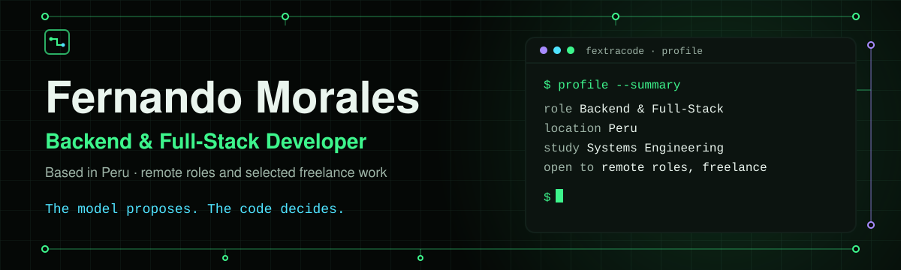

# Fernando Morales

**Backend & Full-Stack Developer · Based in Peru**

Remote roles and selected freelance work · Backend services · Web applications · Automation · Windows tooling · Software licensing

**[fextracode.com](https://fextracode.com)** · Spanish & English website

[Website](https://fextracode.com) · [Case studies](https://github.com/FerS00/portfolio) · [About](#about-me) · [Stack](#stack) · [Selected work](#selected-work) · [Contact](#contact)

[LinkedIn](https://linkedin.com/in/fernando-trinidad-morales-pe%C3%B1a-3632b2391) ·
[Email](mailto:moralespenafernando@gmail.com) ·
[Telegram](https://t.me/FerS_00) ·
[GitHub](https://github.com/FerS00)

---

## About me

I'm a **Systems Engineering student** and software developer building applications that have to operate under real technical and business constraints. My work includes web applications with **Angular and Spring Boot**, backend services in **Java and Python**, and native Windows utilities written in **C++ and C#**.

I'm particularly interested in business workflows, automation, software licensing, offline environments, legacy Windows applications and integrations with existing software.

I use AI as a **development tool**, not as a substitute for software engineering: architecture, business rules, validation, security decisions and final verification remain explicit parts of my process. When a project integrates an LLM, the model may interpret requests or propose operations, but deterministic application code validates permissions, arguments and business rules before any sensitive action is executed.

> **The model proposes. The code decides.**

I'm open to **remote roles** and **selected freelance projects** in backend engineering, full-stack web development, automation and applied AI.

## Stack

- **Backend:** Java · Spring Boot · Python · FastAPI · C# · .NET
- **Frontend:** Angular · React
- **Data:** MySQL · MariaDB · SQLAlchemy · Flyway
- **Native Windows:** C++ · Win32 API · Windows CNG · Windows Forms
- **AI & Automation:** LLM tool calling · LangGraph · agent workflows · human approval flows
- **Infrastructure:** Docker · GitHub Actions · REST APIs · SSE

## Selected work

Start with these three projects.

### [Overseer](https://github.com/FerS00/Overseer) · Testing / preview

Local, read-only, real-time activity monitor for Claude Code and Codex, with an animated pixel mascot for each agent.

Agent hooks and Codex session rollouts feed a single event stream that is redacted before storage, deduplicated and replayed to the dashboard over Server-Sent Events after reconnects. File readers persist byte offsets so they resume after restarts, and the server binds to loopback with a token-protected ingest endpoint by default.

Overseer only observes agent activity; it never sends commands to either agent.

`Java 21` `Spring Boot 3.5` `Angular 22` `Node.js 24` `H2` `Flyway` `SSE` `Docker` `Playwright`

**Public source · MIT**

---

### [OPERATIX](https://github.com/FerS00/OPERATIX) · MVP

Sales assistant that converts natural-language requests into validated business operations.

The LLM interprets the request and proposes tool calls, but it does not write directly to business data. The application validates arguments, permissions and business rules, handles idempotency and controls what can be written to Excel, Google Sheets or MySQL.

It also includes per-currency reporting, a React dashboard and Telegram confirmations for operations that require explicit user approval. Production deployment is out of scope for this MVP.

`Python` `FastAPI` `LangGraph` `SQLAlchemy` `MySQL` `React` `Docker`

**Public source**

---

### [VENTAS_DPP case study](https://github.com/FerS00/portfolio/blob/main/projects/ventas-dpp/README.md) · Private source · not in production

Web storefront and back office built to replace a hosted store for a software reseller.

The system covers catalog management, bundles, offers with price snapshots, customer accounts with one-time codes, permission-based administration, notifications, spreadsheet synchronization and XLSX/PDF exports.

It also includes a guided assistant with an optional LLM-backed mode, while the application's business logic remains independent from the model.

`Angular 20` `Spring Boot 3.4` `Java 17` `Spring Security` `Flyway` `MariaDB / MySQL` `Docker`

**Private source · [Read case study](https://github.com/FerS00/portfolio/blob/main/projects/ventas-dpp/README.md)**

## Additional work

### [RelayForge](https://github.com/FerS00/RelayForge) · Paused / early development

Self-hosted work console for coordinating coding agents (Claude Code, Codex, and Antigravity) on Windows.

Claude Code handles planning, Codex implements changes within isolated Git worktrees, declared checks verify test/lint suites, and Antigravity executes read-only audits. The operator retains full control with human-approved delivery actions (commit/push). Includes resilient process supervision via Windows Job Objects, real-time SSE streaming, and secure remote access through Tailscale Serve with pairing codes.

`Python 3.13+` `FastAPI` `React` `TypeScript` `SQLite` `Tailscale` `Windows Job Objects`

**Public source · Apache-2.0**

---

### [WLQuickGen](https://github.com/FerS00/WLQuickGen)

Portable Win32 utility for generating licenses for software protected with WinLicense.

It detects the available generator SDK and architecture automatically, writes license files atomically and exposes stable control IDs so its interface can also be automated using tools such as pywinauto.

The application is available in English, Spanish and Portuguese.

`C++17` `Win32 API` `CMake` `GitHub Actions`

**Source-available · PolyForm Noncommercial**

---

### [LICENSE-SERVICE](https://github.com/FerS00/portfolio/blob/main/projects/license-service/README.md)

Offline licensing system for .NET desktop applications.

A packager prepares an existing executable, the customer generates a hardware-bound request code, and a separate issuer workstation produces the activation response.

Licenses use ECDSA P-256 signatures and authenticated encryption, while signing material remains isolated on the issuer machine.

`C#` `.NET 10` `Windows Forms` `ECDSA P-256` `AES-GCM` `Docker`

**Private source · [Read case study](https://github.com/FerS00/portfolio/blob/main/projects/license-service/README.md)**

---

### [Hwid-Keygen-Core](https://github.com/FerS00/portfolio/blob/main/projects/hwid-keygen-core/README.md)

Offline activation layer built around an unusual constraint: the original application source code is unavailable and only the WinLicense-protected executable can be extended.

A native plugin executes before the application, derives the hardware identity and verifies an ECDSA P-256 signed activation response generated on a separate issuer machine.

`C++17` `Win32` `Windows CNG` `CMake`

**Private source · [Read case study](https://github.com/FerS00/portfolio/blob/main/projects/hwid-keygen-core/README.md)**

## Private projects

Some of my work cannot be published because it contains proprietary code, customer-specific integrations or implementation details that should remain private. For these projects I publish technical case studies explaining the problem, architecture, design decisions, security model and technologies without exposing the original source code.

**[Browse the case studies →](https://github.com/FerS00/portfolio)**

## Contact

I'm open to remote software development roles, selected freelance projects and technical collaborations.

- **Website:** [fextracode.com](https://fextracode.com) · Spanish & English
- **Case studies:** [github.com/FerS00/portfolio](https://github.com/FerS00/portfolio)
- **LinkedIn:** [Fernando Morales](https://linkedin.com/in/fernando-trinidad-morales-pe%C3%B1a-3632b2391)
- **Email:** [moralespenafernando@gmail.com](mailto:moralespenafernando@gmail.com)
- **Telegram:** [@FerS_00](https://t.me/FerS_00)
- **GitHub:** [@FerS00](https://github.com/FerS00)

If you're interested in one of my private projects, I can discuss its architecture, my responsibilities and the technical decisions involved without exposing confidential source code.
